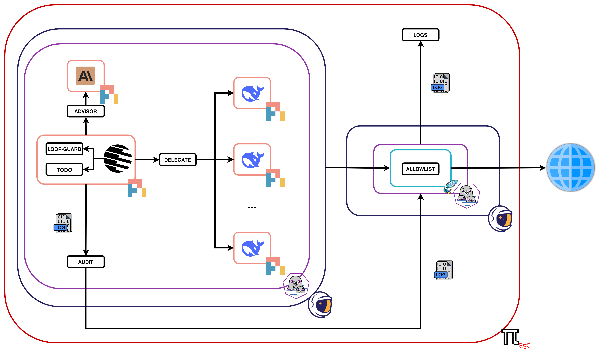

<div align="center">
 
  <br/>

  <p><i>a lightweight, hardened pi harness for security work</i></p>
  <br />
</div>



## Quickstart

Requires rootless Podman, `podman-compose` and [gVisor](https://gvisor.dev/docs/user_guide/install) (`runsc`).

```sh
$EDITOR pisec.conf                   # network, packages, mounts
$EDITOR agent/config/providers.env   # API keys (tracked template: don't commit your keys)
$EDITOR agent/config/settings.json   # models
make pod-build
make pod-shell
make pod-run TASK="..."              # or headless: prints the final answer
```

The agent runs in a gVisor container whose only way out is the `pisec-gw` gateway. Its workspace is `shared/`.

On a fresh Debian 13 or Fedora host: install `podman`, `podman-compose`, `make` and `runsc` (plus `passt` on Debian), and run `loginctl enable-linger` so the gateway keeps running after you log out. If the gateway exits with nftables "Operation not supported", load the missing module (e.g. `sudo modprobe nft_log nfnetlink_log`).

## Using it on a lab

1. Give it the lab: put your notes, scope and credentials in `shared/labs/<name>/` (e.g. `LAB.md`, `scope.md`, `credentials/`), or mount a folder with `[mount]`.
2. Open the network: add the lab's endpoints to `[allow]` (e.g. `10.1.10.10 tcp/443`), then `make gw-reload`.
3. Start: `make pod-shell`, or `make pod-run TASK="Get started on the <name> lab: ..."`.

Any layout works; the agent asks for target and scope when they are missing.

## Configuration

`pisec.conf` (commented inline):

| Section | Contents | Apply |
|---|---|---|
| `[allow]` | domains (HTTP/S via proxy) and IPs/ports (direct); everything else is dropped | `make gw-reload` |
| `[hosts]` | `name ip` for hosts only your LAN resolves | `make gw-reload` |
| `[packages]` | Fedora packages for the agent image | `make pod-build` |
| `[mount]` | host paths, read-only under `/usr/local/src/` | `make pod-shell` |

`agent/config/settings.json` picks the models; one is enough:

| Setting | Role | If unset |
|---|---|---|
| `defaultProvider` / `defaultModel` | main agent | required |
| `delegateModel` | `delegate` subagents | main model |
| `advisorEnabled` / `advisorModel` | `advisor` reviewer | off / main model |

Built-in providers (Anthropic, OpenAI, Google, OpenRouter, ...) need only a key in `providers.env`; subscriptions use `/login` in the shell; custom endpoints go in `models.json`. Either way, the provider's host must be in `[allow]`.

MCP servers go in `agent/config/mcp.json` (the usual `mcpServers` format; untracked, mounted read-only when present); remote ones need their host in `[allow]`.

pi is pinned in `agent/Containerfile` (`PI_VERSION`); bump it deliberately, since the extensions use its API.

## Logs

`logs/` holds the gateway's audit trail; read it with `less`, since tool arguments are agent-controlled:

- `tools.log`: every tool call and its outcome
- `proxy.log`: every proxied request
- `net.log`: every direct connection allowed or dropped

Full transcripts are in `agent/sessions/`.

## Extensions and skills

- `advisor`: asks a reviewer model for a verdict and next steps; when enabled, every multi-step task gets one final review before the answer.
- `delegate`: runs a task in a fresh subagent and returns a short report.
- `loop-guard`: stops repetition loops and calls that keep returning the same result.
- `todo`: task list with one task in progress at a time.
- `audit`: sends tool calls to `tools.log`.

Skills are loaded only when a task needs them: `red-team`, `labs`, `research-threads`. Add your own as `agent/config/skills/<name>/SKILL.md`.
